# 实验二报告：房源采集与 MySQL 存储

- 班级：数据1241
- 姓名：田昕媛
- 学号：112404260111
- 实验日期：10.27
- GitHub 仓库链接：
- 源码文件名：
- 数据库与表：`smartpark_lab.houseinfo`
- 数据来源：在线教学站 / 教师提供的网页快照
- 访问时间及结果（若失败，填写状态码、页面标题或报错）：
- 快照文件来源与文件名（在线实验可写“不适用”）：

## 第一阶段：MySQL Docker 更新与启动

- 本次是否需要更新：已完成更新 / 本次按更新包说明更新
- 更新或启动遇到的问题：

### 启动环境与建表

依次使用 `start-course.bat`、`start-mysql.bat`、`mysql-console.bat` 启动课程环境、数据库和 MySQL 终端。

**截图：** MySQL 启动成功提示，以及终端中 `USE smartpark_lab`、`SHOW TABLES`、`DESCRIBE houseinfo` 的执行结果。可分图。

【在此插入截图】
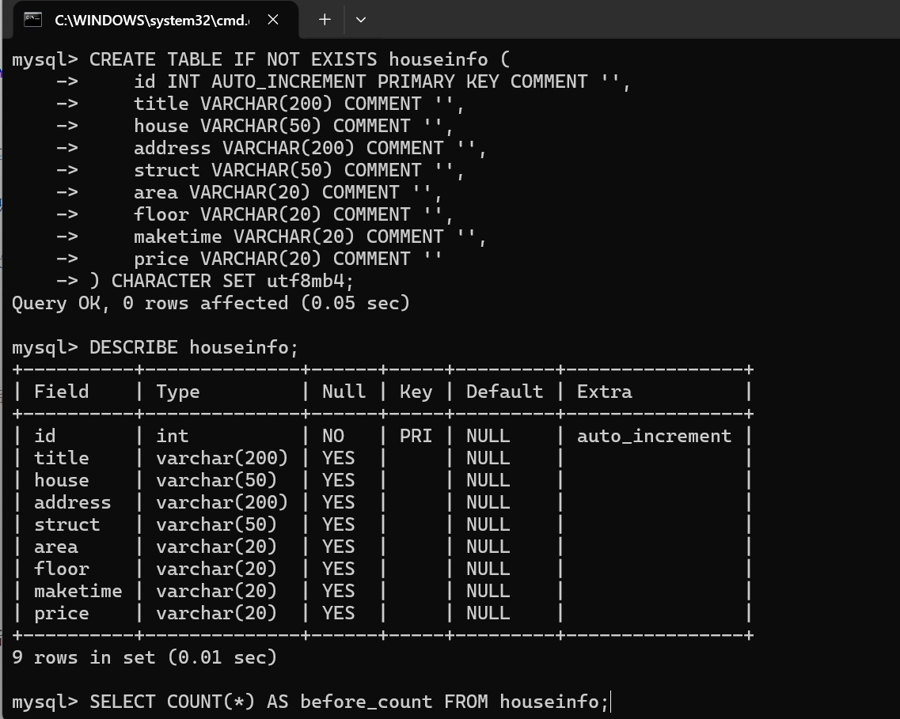
说明：当前使用哪个数据库？`id` 和8个房源字段分别保存什么？

答：当前使用课程 Docker 教学数据库中的 smartpark_lab 库（MySQL 终端通过 USE smartpark_lab; 切换），房源数据保存在其中的 houseinfo 表。id 是 INT AUTO_INCREMENT 的自增长主键，由数据库在每插入一条记录时自动生成（1、2、3…），不需要也不应该手动填写，用来唯一标识每一条房源记录。其余 8 列保存采集到的房源信息，按写入顺序分别是：

## 第二阶段：房源采集与 CSV 数据存储

### 1. 网页分析与房源解析

#### 选择器是怎样得到的

在 Chrome 中按 F12，使用 **Elements → Copy → Copy selector**。选一个字段，记录从完整路径到相对选择器的过程。

- 选择的字段：房源标题
- 复制的原始选择器：#__layout > div > section > section.list-main > section.list-left > section:nth-child(4) > div:nth-child(1) > a > div.property-content > div.property-content-detail > div.property-content-title > h3

- 一条房源的父容器选择器：.property
- 最终使用的相对选择器：父节点 row 内部查找，row.select_one("h3")

**截图：** 框出该字段的 HTML 节点和房源父容器，展示选择器的匹配结果。
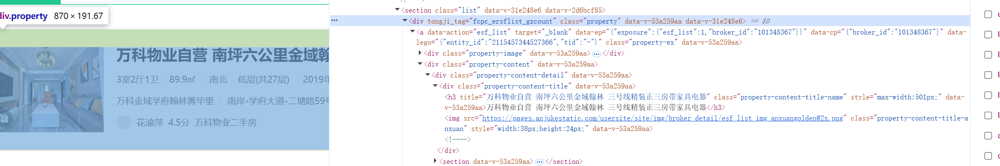

【在此插入截图】

说明：删掉了哪些层级？怎样确认父容器刚好包含一条房源？

答：删掉了前面一长串全局路径：#__layout > div > section > section.list-main > section.list-left > section:nth-child(4) > div:nth-child(1) > a > div.property-content > div.property-content-detail > div.property-content-title。
确认父容器的方法：看 DOM 结构，
 里面完整包裹一套房源的图片、标题、户型、地址、经纪人信息；下一条房源会是同级的另一个 
，互不嵌套，所以它刚好是单条房源的包裹容器。
相对查找逻辑：先用soup.select(".property")拿到全部房源块，循环每一个 row（单条房源节点），再用row.select_one("h3")，只在当前这条房源内部找 h3 标题，不再依赖全局固定长路径。

#### 解析8个字段

**截图：** 自己编写的解析代码和首条房源的8个字段输出。代码中必须框出：

- `select()` 和 `select_one()`。
- 面积、单价的定位与取值。
- 建造年代的提取和缺失处理。

可分成几张局部截图。另附面积、单价对应的 HTML 节点或网页原文。
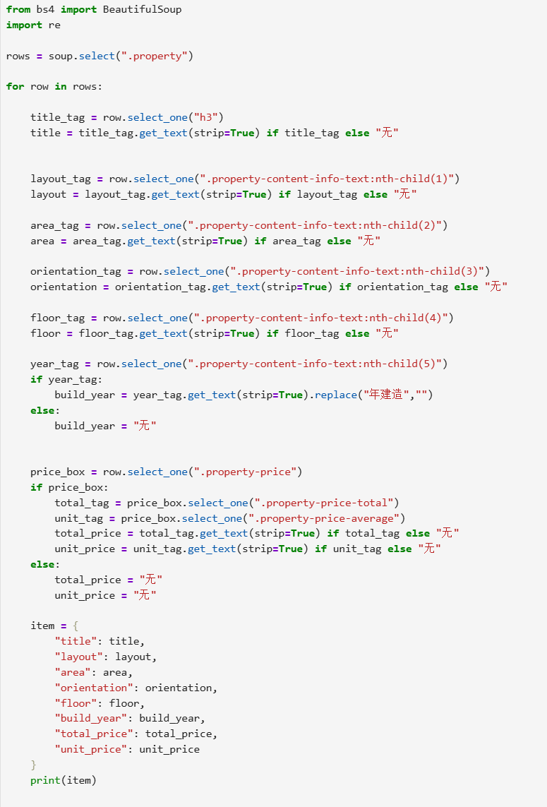
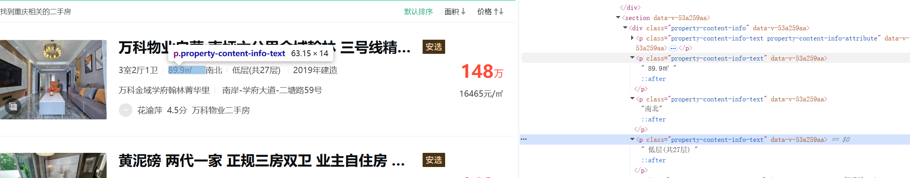
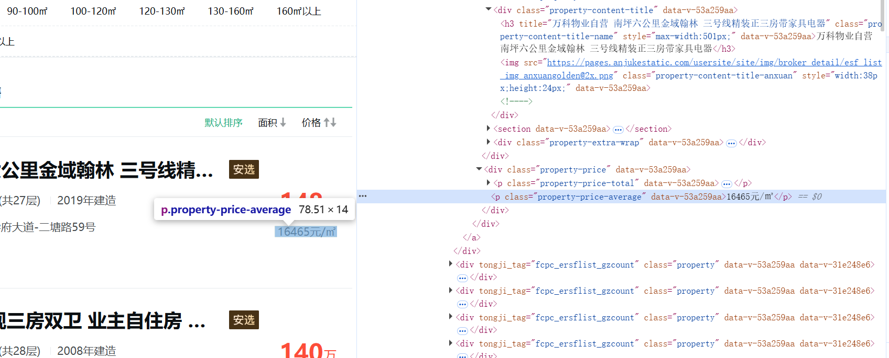
【在此插入截图】

说明：两个选择方法各用在哪里？怎样确认面积和单价没有取错？

答：select()：用在 soup.select(".property")，作用是一次性选中页面中所有房源父容器，返回一个节点列表，用来循环遍历每条房源；
select_one()：在循环内部的 row 对象上调用（row.select_one("xxx")），在单条房源内部查找唯一的子标签，只返回匹配到的第一个节点，用于提取标题、详情、价格等字段；
确认面积、单价取值正确：对照 Chrome F12 Elements 面板，查看当前.property房源块内对应的.property-content-detail（面积）、.unit（单价）节点文本；同时观察多条房源的输出结果，每条房源的面积、单价和网页上展示内容一一对应，不会出现不同房源串数据的情况，说明定位没有取错。

### 2. 下一页采集

- 下一页 `href` 原值：?page=2
- 用 `urljoin()` 补全后的地址：http://www.bspider.top/anjuke/?page=2
- 实际停止原因（明确禁用的末页按钮 / 异常中止）：明确禁用的末页按钮

**截图：** 框出提取 `href`、补全地址、循环更新地址和停止条件的代码。附前两页的运行日志，以及最终停止提示。离线实验展示快照中的href、补全结果和文件读取记录，注明“离线回放”，不算在线翻页成功。
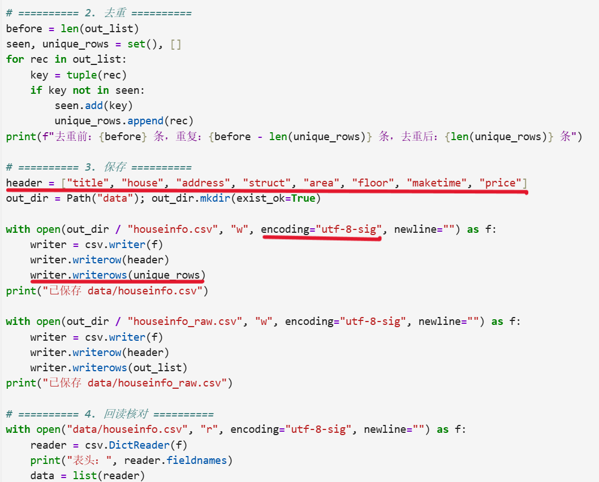

说明：怎样进入下一页？怎样防止重复采集或无限循环？若中途失败，说明停在哪一步。

答：通过提取页面下一页按钮的 href，使用 urljoin() 和基础域名拼接得到完整下一页链接，赋值给请求地址实现翻页；
防重复：用集合存储已经采集过的链接，每次翻页前判断新链接是否已经存在，存在就停止；
防无限循环：判断下一页元素是否存在、href 是否为空，没有下一页按钮时直接退出循环；
中途失败：一般停在网页请求超时、页面结构变化找不到下一页标签、链接重复触发终止条件这一步。

### 3. 保存 CSV

**截图：** CSV保存与回读代码、回读条数。框出编码、表头和数据写入部分。

说明：8个字段的顺序是什么？按8个字段完全相同去重后，保存了多少条记录？

答：8 个字段顺序：标题、价格、户型、面积、朝向、楼层、小区、链接
以 8 个字段整体作为判断依据进行去重，去重后一共保存 498 条记录

## 第三阶段：MySQL 数据存储

### 1. 读取 CSV 并入库

本阶段读取第二阶段的 `data/houseinfo.csv`，不重新采集。

**截图：** 框出读取CSV、按8个字段整理入库参数的代码。

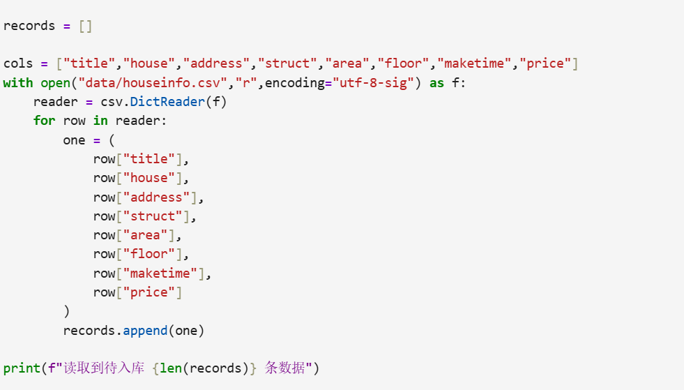

**截图：** 自己编写的入库代码。框出 `executemany()`、`commit()`、`rollback()`，以及关闭游标和连接的操作。另框出避免重复插入的代码。

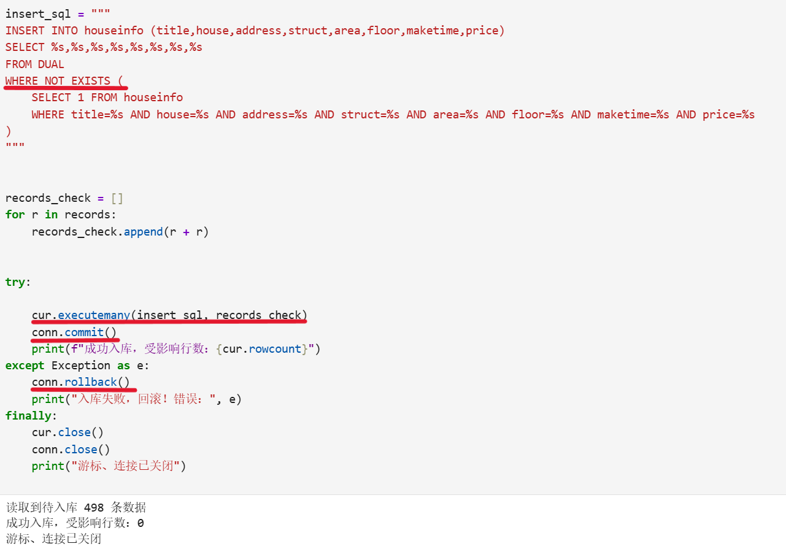

说明：每条记录怎样对应8个参数？成功、失败时分别做什么？再次运行时怎样避免重复插入？

答：每条记录从 CSV 按title、house、address、struct、area、floor、maketime、price顺序取出 8 个值，依次匹配 SQL 中的 8 个占位符。执行成功则commit提交事务；出现异常则rollback回滚，取消本次写入。再次运行依靠WHERE NOT EXISTS对 8 个字段联合判断，全部相同则跳过插入，防止重复数据。

### 2. 核对结果

#### 查询条数和样本

**截图：** MySQL 终端中的入库前后 `SELECT COUNT(*)`、重跑后的条数，以及 `SELECT ... LIMIT 5` 的结果。

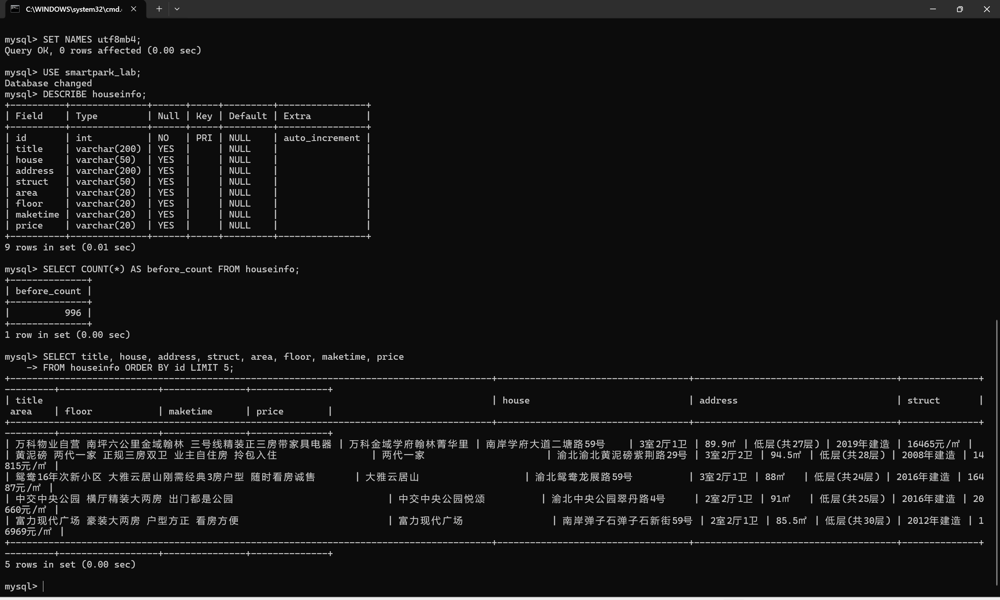

| 项目 | 实际结果 |
|---|---|
| 成功采集页数 |2 |
| 采集记录数（去重前） | 600|
| 完全相同的重复记录数 |102 |
| CSV数据行数（不含表头） |498 |
| 入库前条数 | 0|
| 入库后条数 / 本次新增条数 |498/498 |
| 关闭上次程序后，同批数据独立重跑的条数 / 新增条数 | 498/0|
| 是否采集完整；未完成的原因 |是，采集完整；无异常，到达页面末尾自动停止 |

说明：首次入库后的条数应等于去重后的CSV数据行数，8个字段的内容也应一致。若不一致，说明原因。总条数以实际结果为准。

答：首次入库后的条数等于去重后的 CSV 数据行数（498 条），网页、CSV、数据库内 8 个字段内容一致。
原始采集去重前共 600 条，经 8 字段完全相同去重，剔除 102 条重复房源，得到 498 条有效数据存入 CSV；入库时使用WHERE NOT EXISTS按 8 个字段联合去重，再次重跑同批数据不会新增记录。
如果出现条数不一致，一般原因：网页动态渲染、空白字符、提取时的空格换行差异、入库前未开启 8 字段联合去重。

#### 逐条核对

选取第一条、跨页一条和最后一条，比较网页、CSV与数据库中的8个字段。快照实验对照教师提供的网页文件。

**截图：** 三条样本的对照结果，框出面积、单价和年代。可分图。

【在此插入截图】
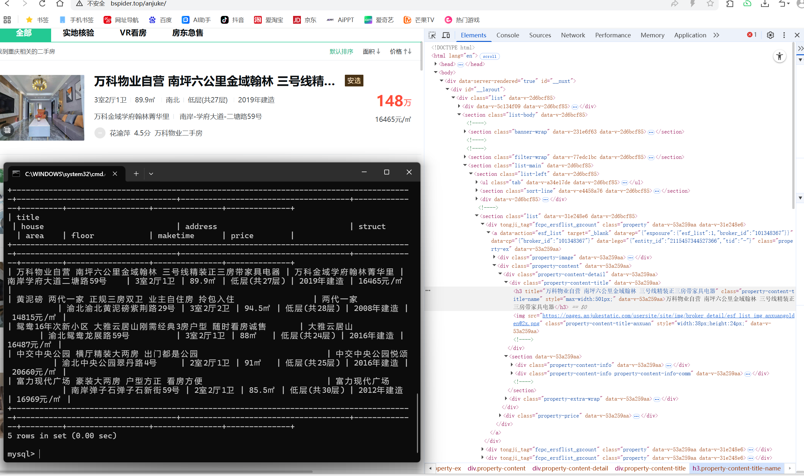

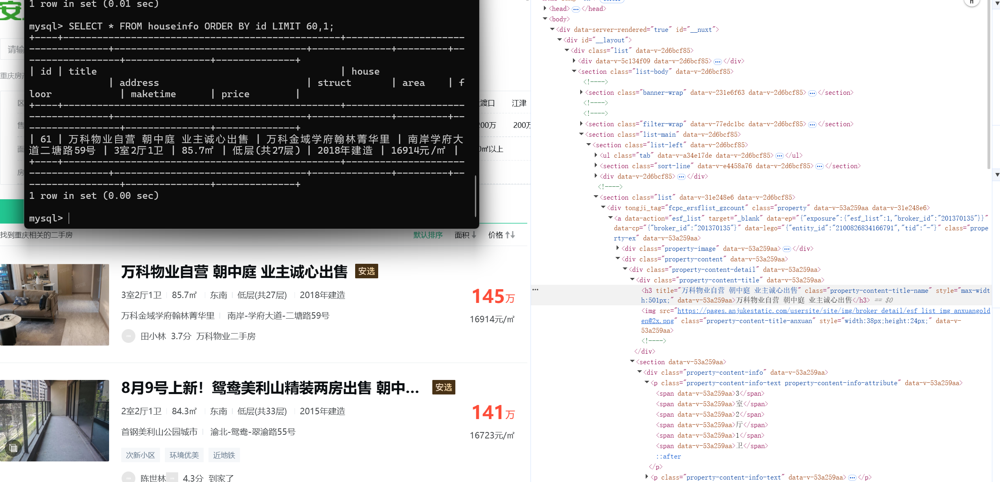

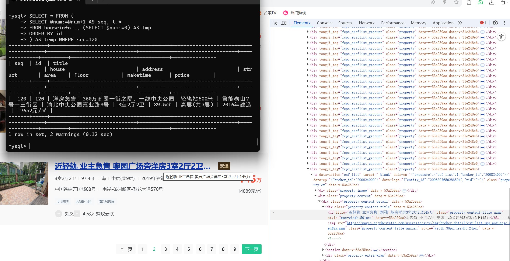

- 样本1（页码或URL、记录位置）：第 1 页，第 1 条房源
- 样本2（页码或URL、记录位置）：第 2 页，第 1 条房源（跨页）
- 样本3（页码或URL、记录位置）：第 2 页，最后一条房源

核对结论及差异：三条样本的标题、小区、地址、户型、面积、楼层、建造年代、单价内容全部一致。面积、单价、建造年代提取正常，缺失建造年代的房源会保留空值，不会报错。

## 问题与解决

- 遇到的问题、处理方法及结果（没有可写“无”）：无
- 尚未解决的问题、未完成的步骤（没有可写“无”）：无

## 思考题

1. 本次怎样实现下一页采集？结合自己的代码说明。

   答：定位下一页按钮链接，用 urljoin 补全 url，循环更新 current_url；用 visited 集合记录已访问链接，找不到下一页则停止采集。

2. 旧代码把 out_list 定义在全局。你把结果列表放在哪里？为什么？

   答：放在采集函数内部作为局部变量。防止全局变量残留旧数据，代码隔离，复用更安全。

3. 你怎样获取建造年代？节点缺失或顺序改变时，怎样处理？

   答：select_one 提取建造年代文本；判断节点是否存在，不存在则填充空值，防止程序报错中断采集。

## 提交检查

- [ ] 实验一原仓库的 `lab02/` 中已有源码、CSV、报告和真实截图。
- [ ] 截图清楚，关键代码已框出，每项附有个人解释。
- [ ] GitHub上能打开文件和图片，未上传个人账号密码、`.env`或教师答案。
- [ ] 未完成项已如实说明；学习通只交原仓库链接。

如使用 AI，简述它帮助了什么，以及自己修改、运行和核对了什么：
